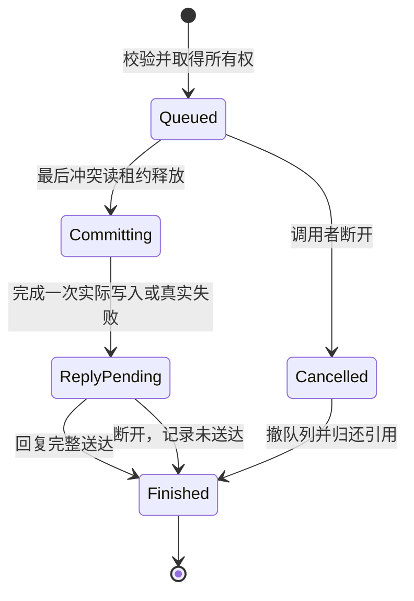

# HY2：共享context的延期回复切分

2026-10-13。接续42/54，完成可在Mac独立准备的协议切分；是未采用设计，不是context实现、运行验证或新的测试工程。0009/0010仍只处理对象/主令牌候选，不足以启用本方案。

## 新核对的宿主事件边界

固定CX树`server/request.c:225–362`将当前handler的reply放在栈上，通过全局current发给该线程，返回后释放variable input；`thread.h:68–77`的error、req/reply和remaining字段也属于该连接。`thread.c:610–650`在kill阶段释放这些内存及fd。因此等待写者不能保存原handler栈指针、req_data或“稍后再调用同一handler”；不能借解锁线程的current/error/reply字段回复另一个线程。

**新增Mac前置问题：** 当前配置HAVE_KQUEUE=1。`fd.c:640–663`对events=0禁用READ/WRITE两个filter，`fd.c:718–723`只有收到kevent才把EV_EOF转换为POLLHUP；`thread.c:590–599`再据此kill/cleanup。不能把Linux/poll中“停POLLIN仍可见HUP”的假设直接搬来。苹果[kevent说明](https://developer.apple.com/library/archive/documentation/System/Conceptual/ManPages_iPhoneOS/man2/kevent.2.html)明确禁用的事件不返回，pipe的末端断开通过EOF报告。源码推断：若延期请求将自己的fd设0，且客户端只退出一个线程而进程仍活着，不能单靠该fd保证及时回收租约；这是尚未复现的风险，不是当前实际挂死证据。

本次新增source anchor（相对同一server根）：thread.h SHA256`efa6ee552a7445584667316d9085eb2257eaf4931c5c4b467050f4d871e4bbda`。request.c/thread.c/fd.c摘要与42相同，配置来自独立复用构建的include/config.h。没有运行kqueue探针或合成断线测试。

## 可实现的协议切分（提案）

### 1. 等待对象必须自己拥有数据

每个连接最多一个未回复RPC；等待项拥有caller thread强引用、请求种类、经校验的输出容量、输入副本、已解析目标token引用/访问范围、队列链接、结果header/payload及终态。创建失败当场回真实错误，不进入“已延期”状态。输入大小沿现有协议边界校验，不把原req_data的地址当所有权。

主体与拥有者分开：captured subject是明确活动请求映射的客户线程/进程；等待/租约拥有者是实际发起RPC的宿主连接；不能用最后client_tid、token modified_id或复用handle作为其中任一个身份。context采用不可复用标识并保持实际primary/client引用，两个相同对象去重，nested lease只计实际持有量。跨工作线程移交的允许范围仍待原生契约，不预置“任意连接都可unlock”。

### 2. 终态只有一个，提交与送达分开

等待者按保存的对象/输入执行实际mutation，不重放依赖current的handler。commit先固定终态归属、摘除队列，再变更一次；执行/回复不重入另一handler的全局状态。写已提交后客户端断开不自动撤销token变更，不能把“回复未送达”伪装成“没执行”。结果以独立caller参数传送；部分payload发送沿既有连接状态继续，失败走真实kill/cleanup，只有完整发送才允许该连接的下一个请求。

### 3. 暂停请求处理时保留死亡观察

提案保留pending连接的READ观察，thread_poll_event在pending状态只处理EOF/错误及非法额外协议数据；不调用普通read_request覆盖旧req，也不把未消费数据作为无操作事件忙循环。同步客户端正常不会发送第二个请求；若pending期间收到额外字节，明确作为协议错误清理。不能仅设置events=0后假定还会收到kqueue EOF。回复过程中如何沿用写事件/异常路径，须在同一切分里证明，不能创建一个无法检测失联的等待项。

cleanup_thread须先从写队列移除该caller等待项、撤销它拥有的租约，再处理payload/fd；清理可能触发其他等待者，但不能递归重新清理同一项或使用即将释放的caller。对象强引用延寿不替代kill阶段撤销。普通IRP cancel不是这个RPC的取消，二者不能互用状态。

## 仍不能据此实施或采用的决策

同步writer如果由持有冲突读租约的同一连接发起，会阻止该连接再发unlock；这是54已有死锁推断。嵌套重叠context、跨线程release、自冲突写及槽位替换是否阻塞，需要原生规则。不能随意给Windows接口发明“成功升级读锁”或一个猜测的错误码。writer preference也不能阻断已有读者的合法nested lock。未解决这些点，SeLock/Unlock依赖组仍属不支持，不能因新协议存在而放行。

下一实现切分为：明确主体及模拟附件实际状态 → 连接所属context/租约 → caller-owned延期transport与死亡观察 → 两个实际mutation门控。各层待独立Windows kernel/reference及候选失败/并发证据；现有Win32结果不代替它们。收益是把回复所有权和Mac死亡观察前置，避免新增锁后泄露租约或错发回复；代价是request/thread/fd与token生命周期必须共同修改。当前仅采用审查条件与切分顺序，未采用运行时设计；回退无需动常用引擎。

当前两个新候选已交付源码/构建。继续关键路径需要处理plan/14已有超额pending和独立参考环境；未获人类新决定前不连接Windows、改账、加载驱动或改启动保护。保留HY1登录/更新人工缺项、原游戏文件和正常启动器，待用户返回后从这一具体节点接续。
